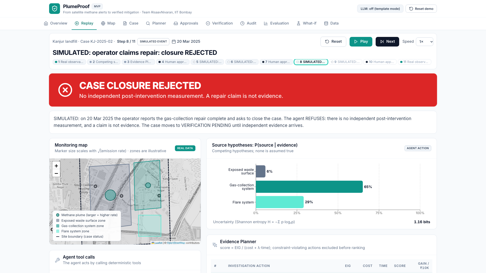
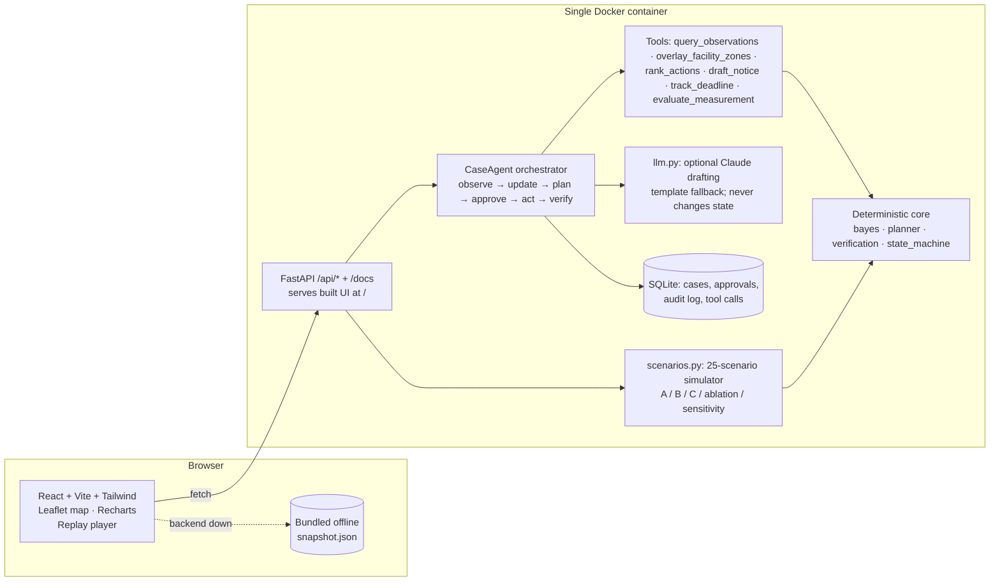

# PlumeProof: from satellite methane alerts to verified mitigation

**Team RisaavNivaran, IIT Bombay · Agentic AI Hackathon 2026 (Ulster University)**

Repository: https://github.com/biprabhanu/RisaavNivaran · Round 2 slides, speech and report: [`round2_submission/`](round2_submission/)

PlumeProof is a persistent AI case agent that turns a satellite-detected methane plume into a managed investigation:

- It keeps competing source hypotheses and updates them with Bayes' rule.
- It picks the next investigation by **expected information gain per rupee and per day**.
- It routes every critical decision through a **human approval queue**.
- It **refuses to close a case until an independent measurement proves the emissions went down**.
- It reopens the case automatically if the emissions come back.

Demo case: the **Kanjur landfill, Mumbai**. The Carbon Mapper observations are real: 9 Feb 2025 (~1,600 + ~136 kg CH₄/h) and 3 Apr 2026 (~3,300 kg/h combined). Every operational event (stakeholder replies, inspector availability, repair claims, follow-up measurement) is **simulated and labelled as such** on screen.



## Why it matters
More than 5,000 UN MARS methane alerts have been issued, and **only 13% get a response**. Detection is solved; follow-through isn't. A repair claim is not a reduction.

## Input → Agent → Output → End users
| Input | What the agent does | Output | End users |
|---|---|---|---|
| Satellite plume observations (Carbon Mapper / MARS), facility zones, wind | Opens a case and resolves the accountable stakeholder; maintains P(source); ranks investigations by EIG / (cost + λ·time); asks humans to approve; tracks deadlines; evaluates measurements with uncertainty; reopens on recurrence | A ranked investigation plan with reasoning, drafted notices, an approval queue, an evidence-chained audit log, and a verdict: **Verified reduction / Inconclusive / Still leaking / Recurring** | Landfill operators and municipal corporations; pollution control boards; UN IMEO/MARS focal points |

## Architecture

**Deterministic core, LLM at the edges.** Bayes updates, entropy, EIG, ranking, the verification rule and every state transition are plain, unit-tested Python. The LLM (optional) only drafts text. If it *requests* a status change, the request is validated against the transition table like any other.

## The maths, in one screen
- Hypotheses h ∈ {waste surface, gas collection, flare}, prior 0.50 / 0.35 / 0.15, so **H = −Σ P log₂ P = 1.44 bits**
- Bayes: P(h | y) ∝ P(y | h, a) · P(h)
- **EIG(a) = H(P) − Σ_y P(y) · H(P(· | y))**, and **score(a) = EIG(a) / (cost + λ·time)**. Constraint-violating actions are excluded *before* ranking.
- Worked example (computed and tested): records 0.50 bits / ₹2k / 1 day, which ranks **first** above ground survey 0.91 bits / ₹60k / 5 days; P(fault) = 0.43, giving gas 65% / flare 29% / waste 6%.
- **Verified reduction ⇔ (post + u_post) < (pre − u_pre)** with an independent measurement under comparable conditions. A claim alone keeps the case VERIFICATION_PENDING; conflicting measurements give INCONCLUSIVE.

## Evaluation (simulated, 25 seeded scenarios; generated by code, see docs/EVALUATION.md)
| Policy | False closures | Source-ID inspections / case | Days to stakeholder | Traceability |
|---|---|---|---|---|
| A: Alert-only | 25 / 25 | 0.00 | 30.0 | 0% |
| B: Fixed checklist | 25 / 25 | 1.80 | 7.0 | 82.8% |
| **C: PlumeProof** | **0 / 25** | **0.72** | **1.0** | **100%** |
| C-ablation (planner off) | 0 / 25 | 0.84 | 1.0 | 100% (but 78.8 vs 46.7 days to closure) |

With every likelihood perturbed by ±20% (200 draws), the top-ranked action is unchanged in 100% of draws, and C still has 0 false closures.

## Quickstart
**Docker (recommended; one command, everything included)**
```bash
git clone https://github.com/biprabhanu/RisaavNivaran.git && cd RisaavNivaran
docker build -t plumeproof .
docker run -p 8000:8000 plumeproof
# open http://localhost:8000  (API docs: http://localhost:8000/docs)
```

**Dev mode**: backend (Python 3.12) plus frontend (Node 20+)

macOS / Linux:
```bash
cd backend
python3 -m venv .venv && source .venv/bin/activate      # or: uv venv --python 3.12 .venv
pip install -r requirements.txt
uvicorn app:app --reload --port 8000
# second terminal
cd frontend && npm install && npm run dev                # http://localhost:5173 (proxies /api → :8000)
```
Windows (PowerShell):
```powershell
cd backend
py -3.12 -m venv .venv; .\.venv\Scripts\Activate.ps1
pip install -r requirements.txt
uvicorn app:app --reload --port 8000
# second terminal
cd frontend; npm install; npm run dev
```
Optional: copy `.env.example` to `.env` and set `ANTHROPIC_API_KEY` to turn on Claude drafting. The badge in the header switches from "LLM: off (template mode)" to "LLM: on".

**Tests**
```bash
cd backend && pytest -q                       # engine, state machine, agent, replay, API, evaluation
cd frontend && npm run build                  # type-check + production build
cd frontend && npx playwright install chromium && E2E_BASE_URL=http://localhost:8000 npm run e2e   # full replay e2e
```
**Regenerate artefacts**
```bash
cd backend && python -m plumeproof.scenarios        # docs/EVALUATION.md + docs/evaluation_results.csv
cd backend && python -m plumeproof.export_snapshot  # frontend/src/lib/snapshot.json (offline fallback)
```

## Deploy to Render (free tier, one click)
1. Push this repo to GitHub.
2. In Render: **New → Blueprint**, then pick the repo. Render reads `render.yaml` (one Docker web service, free plan, health check `/api/health`).
3. Optional: set `ANTHROPIC_API_KEY` in the service's Environment tab. Leave it empty for template mode.
4. Wait for the build (~3–5 min) and open `https://<service>.onrender.com`. The database seeds itself on startup; **Reset demo** in the header restores a clean state.

Free instances sleep after inactivity, so open the site a minute before you present. If the backend is unreachable, the UI switches to the bundled **offline snapshot** and the replay still runs.

## Repository layout
```
backend/app.py                 FastAPI app (API + static frontend)
backend/plumeproof/            config, schemas, bayes, planner, verification, state_machine,
                               agent, tools, llm, replay, scenarios, db, kanjur, export_snapshot
backend/tests/                 pytest suite
frontend/src/{pages,components,lib,types}
docs/                          ROADMAP, ASSUMPTIONS, DEMO_SCRIPT, EVALUATION, API_CONTRACT, screenshots/
```

## Honest limitations
- **Operational events are simulated**: stakeholder mapping, inspector availability, records content, repair claims, the follow-up measurement and the evaluation scenarios. Only the Carbon Mapper plume observations are real. Plume positions and zone polygons are approximate, and the wind arrow is illustrative.
- **Likelihoods, costs, times and λ are illustrative demonstration values**, chosen to reproduce our proposal's worked example. They are not yet calibrated with an environmental engineer. See docs/ASSUMPTIONS.md, including the documented gaps of under 0.5 percentage points.
- The geospatial prior is fixed at 50/35/15; deriving it from plume origin and wind is future work.
- The evaluation uses a bounded measurement-noise model, which is what makes C's zero false closures guaranteed rather than probable.
- SQLite instead of PostgreSQL/PostGIS; a hand-written orchestrator instead of LangGraph.
- The ESP32 + MQ-4 sensor from the proposal is **not** a calibrated methane instrument and is **not** used for verification.
- Map tiles need internet; everything else runs offline, with or without an API key.
