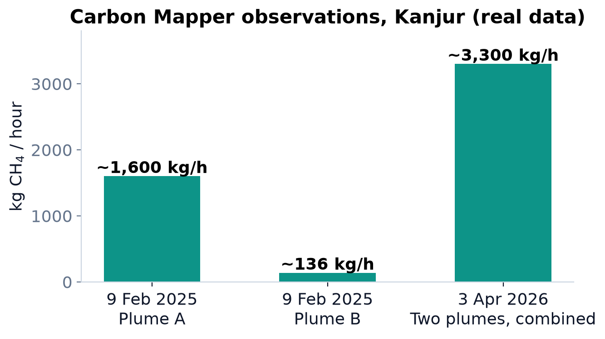
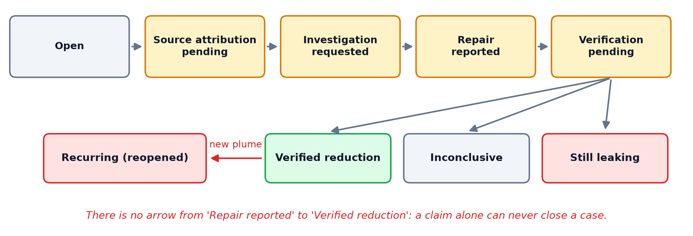
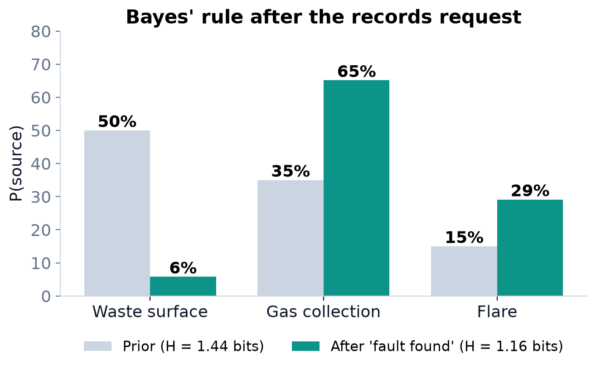
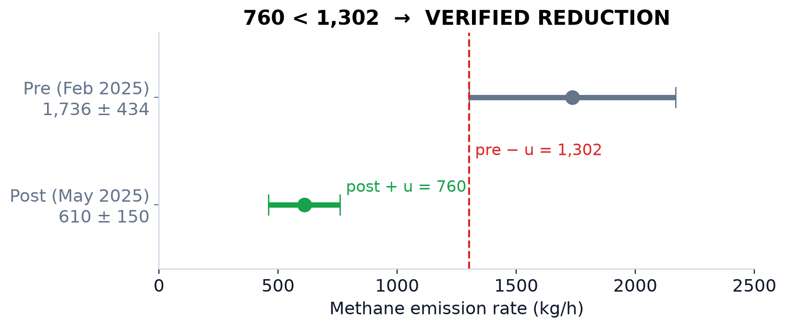
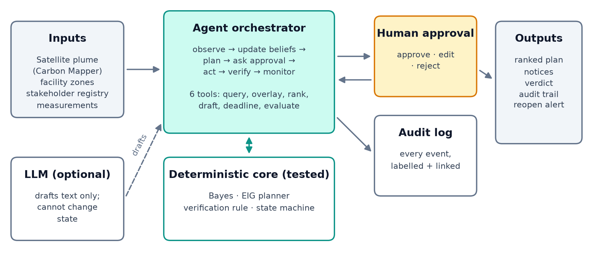
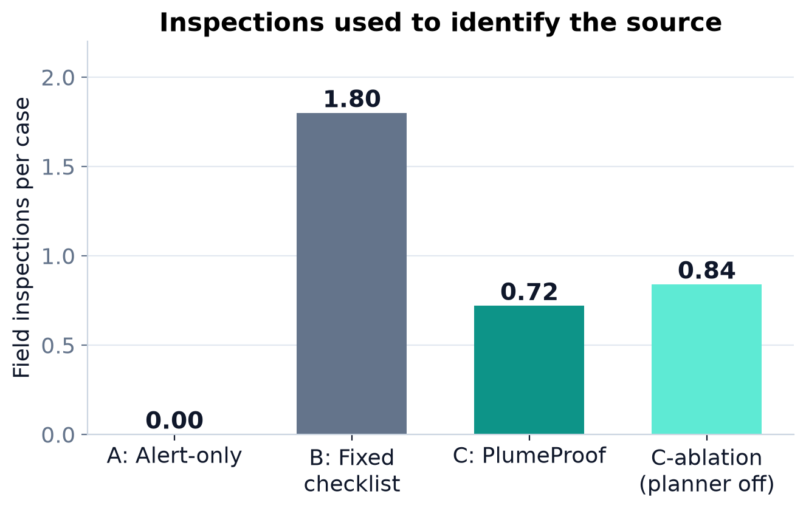
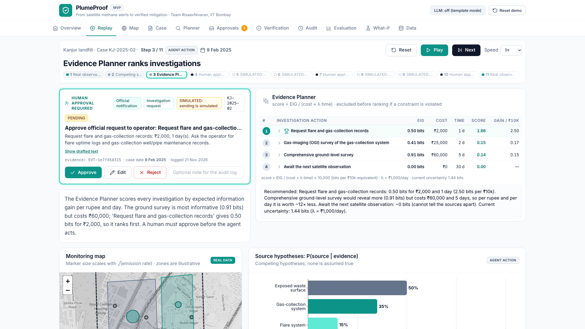
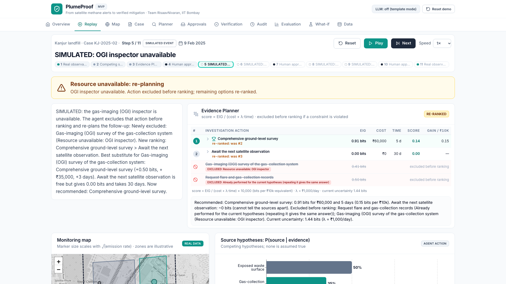
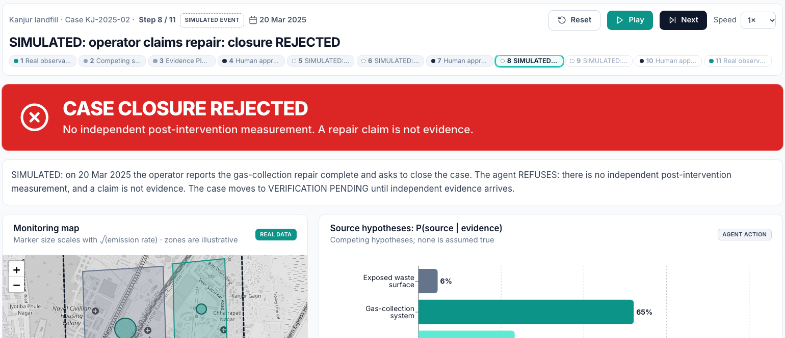
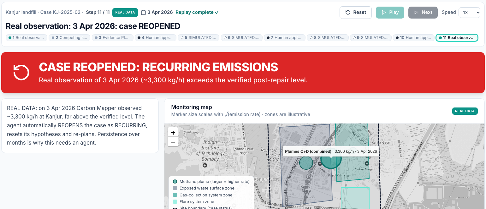

<!--
Round 2 report. Build the PDF from this folder with:
  pandoc round2_report.md -o round2_report.pdf --pdf-engine=tectonic \
         -H assets/style.tex -B assets/titlepage.tex --lua-filter assets/web_only.lua
Diagrams: assets/make_diagrams.py. Charts and screenshots: ../slides/figures/.
Every number comes from ../slides/figures/src/numbers.json, evaluation_numbers.json or docs/EVALUATION.md.
-->

::: web-only
**PlumeProof: From Satellite Methane Alerts to Verified Mitigation**  
Team RisaavNivaran (Team Number: [TEAM NO.]) · Indian Institute of Technology Bombay · Bipra Bhanu Mohanty, Mandar Deshmukh  
Theme: Agentic AI for Climate, Sustainability & Green Innovation  
Live demo: <https://plumeproof.onrender.com> · Code: <https://github.com/biprabhanu/RisaavNivaran>
:::

# Summary

PlumeProof is an AI agent that picks up where satellite methane alerts stop. A satellite can see a large methane plume. It cannot tell you **who** must act, **which** part of the site is leaking, **what to check first**, or **whether a claimed repair really worked**. PlumeProof turns each plume into a case and manages it from start to finish. It keeps several possible explanations open, chooses the cheapest and fastest check that tells it the most, asks a human before any important step, and only closes the case when an independent measurement shows the emissions went down. If a later satellite pass sees the plume again, it reopens the case by itself.

We built a working web app and tested it on a real example: the **Kanjur landfill in Mumbai**, where Carbon Mapper recorded real methane plumes in 2025 and 2026. In 25 simulated test cases, PlumeProof made **0 false closures**, against **25 out of 25** for an alert-only process and for a fixed checklist.

> **In plain words.** A smoke alarm tells you there is smoke. PlumeProof is the person who then finds the fire, calls the right people, checks that the fire is really out, and comes back if the smoke returns.

# 1. The problem and who it is for

## 1.1 Detection works. Follow-through does not.

Methane is a strong greenhouse gas. It drives about 30% of current warming and is about 80 times more potent than CO~2~ over 20 years [1, 7]. Satellites can now spot large methane leaks from space. The UN Methane Alert and Response System (MARS) has sent **more than 5,000 alerts in 33 countries**, but only **13%** of them received a response, meaning the alert was investigated and reported back [1]. The UN target is an **80%** response rate by 2030 [1]. In a separate study, 1,015 AI-based notifications led to verified permanent mitigation at only six persistent emitters [5].

So the hard part is no longer *seeing* methane. The hard part is everything after the alert:

- **Nobody owns the case.** It is unclear which organisation is responsible for the site.
- **The source is unclear.** A large site has several parts that could leak.
- **Checks cost money and time.** An inspection team or a gas camera is expensive and not always available.
- **A repair claim is not proof.** An operator can say "fixed" without any measurement. UNEP notes that satellite data alone cannot confirm mitigation [4].
- **Leaks come back.** A case that was closed can start leaking again months later.

## 1.2 Test case: Kanjur landfill, Mumbai (real data)

A UN analysis named Kanjur landfill among the world's three largest methane sources [3]. Carbon Mapper observed it twice [2]:

| Date | What the satellite saw | Status |
|-----------|----------------------------------------------------|-----------|
| 9 Feb 2025 | Two plumes: about **1,600 kg/h** (Plume A) and about **136 kg/h** (Plume B) | Real data |
| 3 Apr 2026 | Two plumes, about **3,300 kg/h** combined | Real data |

These are two separate snapshots under different conditions, not a continuous trend. Odour-control work at the site reduced complaints, but fewer complaints do not show that methane fell [2]. This is exactly the gap PlumeProof is built for.

{width=48%}

## 1.3 Who uses it

| End user | What they get from PlumeProof |
|-------------------------------|------------------------------------------------------|
| **Pollution control boards** (regulators) | Evidence-linked findings and a closure verdict that a repair claim alone cannot fake |
| **Municipal authorities and landfill operators** | A precise, ranked request (for example "send flare and gas-collection records") instead of a vague alert |
| **UN IMEO / MARS national focal points** | One place to follow many alerts, with deadlines, approvals and a full audit trail per case |

## 1.4 What goes in and what comes out

| | |
|-----------|------------------------------------------------------------|
| **Input** | A satellite plume (location, emission rate, date); the site map with its zones; a list of who is responsible for what; operator records; field measurements |
| **What the agent does** | Keeps competing explanations, updates them after each piece of evidence, picks the next check, drafts requests and notices, tracks deadlines, checks measurements |
| **Human role** | Approves, edits or rejects every important step: source attribution, official notices, field investigations and final closure |
| **Output** | A ranked investigation plan, drafted notices, a verdict (*Verified reduction*, *Inconclusive* or *Still leaking*), a complete audit trail, and an automatic reopen if emissions return |

# 2. The solution: how the agent works

## 2.1 One case, from alert to verified outcome

PlumeProof treats every plume as a **case** that can stay open for months. For each case the agent repeats one loop:

1. **Observe.** Read the new evidence (a satellite plume, a records reply, a measurement).
2. **Update its beliefs.** Recalculate how likely each possible source is (Section 3.1).
3. **Plan.** Rank the possible next checks by how much they are expected to teach us per rupee and per day (Section 3.2). Checks that are not allowed right now, for example because an inspector is unavailable, are removed *before* ranking.
4. **Ask a human.** Important steps go to an approval queue. A person can approve, edit or reject.
5. **Act.** Send the approved request or notice and start a deadline.
6. **Verify.** When a measurement arrives, apply the closure rule (Section 3.3).
7. **Keep watching.** After closure, any new plume above the limit reopens the case.

The agent works through six small tools, each a plain, tested function: `query_observations` (find plumes for a site), `overlay_facility_zones` (match a plume to site zones and responsible people), `rank_actions` (run the planner), `draft_notice` (write a request or notice), `track_deadline` (watch for late replies) and `evaluate_measurement` (apply the closure rule).

## 2.2 The case lifecycle

A case moves through fixed stages. A small rulebook in the code (a "state machine") lists which moves are allowed. Any other move is refused and logged.

{width=92%}

The most important rule is a missing arrow. There is **no move from "Repair reported" straight to "Verified reduction"**. A repair claim can only move the case to "Verification pending". Only an independent measurement can close it.

## 2.3 Why this needs an agent and not a checklist

A fixed checklist runs the same steps in the same order for every site and closes the case when the operator says "fixed". PlumeProof is different in six ways:

| | Fixed checklist | PlumeProof |
|-------------|----------------------------|------------------------------------------|
| **Memory** | One pass, then done | Keeps the case and its history for months |
| **Reasoning** | Same steps every time | Updates its beliefs after every result |
| **Planning** | Fixed order | Chooses the check with the best information per rupee and day |
| **Adapting** | Stalls if a step is blocked | Removes blocked options and re-plans |
| **Closure** | Closes on the operator's claim | Closes only on independent evidence |
| **After closure** | Nothing | Watches for recurrence and reopens |

## 2.4 Humans stay in control

The agent never acts alone on four kinds of decisions: **source attribution**, **official notifications**, **field investigations** and **final closure**. Each one creates an approval item. If a human rejects an item, the agent stops, records the reason, and proposes a revised item. Every event is written to an audit log with a time, the actor, the evidence it links to, and one of four labels: **REAL DATA**, **AGENT ACTION**, **SIMULATED EVENT** or **HUMAN DECISION**.

# 3. Methods, explained simply

This section uses the Kanjur numbers from the app. All of them are computed by the code, not typed in.

## 3.1 Keeping track of what we believe (Bayes' rule)

At Kanjur there are three possible sources, which we call **hypotheses**:

| Hypothesis | Starting belief (prior) |
|------------------------------|-------------------|
| Exposed waste surface | 50% |
| Gas-collection system | 35% |
| Flare system | 15% |

**Uncertainty** is measured in *bits* (Shannon entropy). Zero bits means we are certain. Higher means more unsure. The starting uncertainty is **1.44 bits**.

When new evidence arrives, the agent updates the beliefs with **Bayes' rule**:

$$P(\text{source} \mid \text{evidence}) \;\propto\; P(\text{evidence} \mid \text{source}) \times P(\text{source})$$

In words: *new belief = how well this source explains the evidence × old belief*, then scaled so the beliefs add up to 100%.

> **Worked example: the records request.** Suppose the operator's records show a fault in the gas system. Our tables say such records appear 5% of the time if the waste surface is the source, 80.5% if it is the gas-collection system, and 84% if it is the flare. Multiply each by the prior: 0.50 × 0.05 = 0.025; 0.35 × 0.805 ≈ 0.282; 0.15 × 0.84 = 0.126. These add up to about **0.43**, the chance of seeing "fault found" at all. Dividing each part by 0.43 gives the new beliefs: **gas collection 65%, flare 29%, waste surface 6%**. Uncertainty falls from 1.44 to 1.16 bits. If the records show *no* fault instead, the waste surface rises to **84%**.

{width=48%}

## 3.2 Choosing what to check next (expected information gain)

Before running a check, the agent asks: *on average, how much will this check reduce my uncertainty?* This is called the **expected information gain (EIG)**. It is measured in bits:

$$\text{EIG}(a) = H(\text{now}) - \sum_{y} P(y \mid a)\, H(\text{after seeing } y)$$

In words: *uncertainty now, minus the uncertainty we expect after the result, averaged over the results we might get.* For the records request: 1.44 − (0.43 × 1.16 + 0.57 × 0.78) ≈ **0.50 bits**.

A check is only worth it if it is good value. So the agent ranks checks by **information per unit of cost and time**:

$$\text{score}(a) = \frac{\text{EIG}(a)}{\text{cost}(a) + \lambda \times \text{days}(a)}$$

Here λ (lambda) turns delay into rupees. We use λ = ₹1,000 per day. For example, the records request costs ₹2,000 and takes 1 day, so its denominator is ₹3,000 and its score is 0.50 / 3,000 × 10,000 ≈ **1.66 bits per ₹10,000**. In the table, *Score* is this value (bits per ₹10,000 including the cost of delay) and *Gain/₹10k* is the simpler EIG ÷ cost × 10,000.

| Check (action) | EIG | Cost | Days | Score | Gain/₹10k | Rank |
|-------------------------------------|----------:|---------:|-----:|-------:|------------:|-----:|
| Request flare and gas-collection records | 0.50 bits | ₹2,000 | 1 | **1.66** | 2.50 | **1** |
| Gas-imaging (OGI) camera survey | 0.41 bits | ₹25,000 | 2 | 0.15 | 0.17 | 2 |
| Full ground-level survey | **0.91 bits** | ₹60,000 | 5 | 0.14 | 0.15 | 3 |
| Wait for the next satellite pass | 0.00 bits | ₹0 | 30 | 0.00 | – | 4 |

The ground survey teaches us the most (0.91 bits), but it costs 30 times more than the records request. The records request gives the **most information per rupee and per day**, so it ranks first. Waiting for a satellite is free but gives **0 bits**: a new satellite image shows the plume again, but it cannot tell *which part* of the site is leaking.

> **Re-planning.** If a check becomes impossible, it is removed before ranking and the rest are re-ranked. In the demo, the OGI inspector becomes unavailable. The agent removes the OGI survey (and the records request, which has already been done), and the ground survey moves to first place.

## 3.3 Deciding whether emissions really went down (the closure rule)

Every measurement has an uncertainty, written as "rate ± u". The agent closes a case as **Verified reduction** only if the *highest* plausible value after the repair is still below the *lowest* plausible value before it:

$$\text{post} + u_{\text{post}} \;<\; \text{pre} - u_{\text{pre}}$$

and only if the "after" measurement is **independent** (not the operator's own report) and taken under **comparable conditions**.

> **Worked example: Kanjur.** Before: 1,600 + 136 = **1,736 kg/h**, with an assumed ±25% uncertainty, so ± 434 kg/h. The lowest plausible "before" value is 1,736 − 434 = **1,302 kg/h**. After (a simulated independent measurement): **610 ± 150 kg/h**, so the highest plausible "after" value is **760 kg/h**. Because **760 < 1,302**, the two ranges do not overlap and the verdict is *Verified reduction*.

The other outcomes:

- **Operator claim only, no measurement:** the case stays *Verification pending*. A claim is not evidence.
- **Two independent measurements that disagree:** *Inconclusive*. The agent asks for another measurement.
- **The ranges overlap or emissions did not fall:** *Still leaking*. The agent goes back to investigating.

{width=66%}

## 3.4 Reopening the case

After a verified closure, the agent sets a **recurrence limit**: the larger of the "after" upper value and 100 kg/h. At Kanjur that is **760 kg/h**. Any later observation above the limit reopens the case as *Recurring*. On 3 April 2026, Carbon Mapper saw about **3,300 kg/h**, far above 760, so the agent reopens the case, resets its beliefs and starts planning again.

# 4. Implementation

## 4.1 Design idea: a fixed core, with AI only for writing

All the maths and every change of case status live in plain, tested Python code. The same input always gives the same answer. A large language model (Claude) is used **only to draft text**, such as a notice to the operator or a plain-language explanation of a ranking. It cannot change a number, a ranking, a verdict or the case status. It can only *request* a status change, and the state machine checks that request. If no API key is set, the app writes the same texts from templates. The whole demo runs without any AI key, and a badge in the header shows "LLM: on" or "LLM: off".

> **Why this matters.** A regulator must be able to trust and repeat every decision. Keeping the decisions in tested code, and the AI at the edges, makes every number explainable.

{width=88%}

## 4.2 Technology

| Part | What we used |
|-------------|------------------------------------------------------------------|
| Core logic | Python 3.12: Bayes update, EIG planner, closure rule and state machine as small, separate, tested modules |
| Agent | A hand-written orchestrator that calls the six tools and fills the approval queue |
| Backend | FastAPI with Pydantic data models; SQLite database for cases, approvals and the audit log |
| Frontend | React, Vite and Tailwind; Leaflet map; Recharts charts. Pages: Overview, Replay, Map, Case, Planner, Approvals, Verification, Audit, Evaluation, What-if, Data |
| AI drafting | Optional Claude, with a template fallback |
| Deployment | One Docker container, hosted on Render: <https://plumeproof.onrender.com> |
| Testing | 128 backend tests (maths, state machine, agent, replay, API) and 3 browser tests of the full demo |

If the backend cannot be reached, the frontend falls back to a bundled snapshot, so the pages still show content.

# 5. Evaluation

## 5.1 How we tested it

We could not wait months for real cases to finish, so we built a **simulator**. It creates 25 test cases (seed 2026, so anyone can repeat the run). Each case has a hidden true source and a hidden true emission rate. The simulator answers each check by drawing a result from the same likelihood tables the agent uses. It also adds realistic trouble:

| Situation in the test case | Number of cases |
|----------------------------------------------|----------------:|
| Operator's first repair claim is false | 7 |
| Two measurements disagree | 6 |
| Records request gets no reply in time | 5 |
| OGI inspector unavailable | 5 |
| Emissions come back after closure | 5 |
| Source is hard to tell apart (flat prior) | 5 |
| No special difficulty | 4 |

One case can have several situations, so the column adds up to more than 25. All 25 cases are simulated.

We compared four ways of handling the same 25 cases. Every policy faced exactly the same hidden world.

- **A: Alert-only.** Send an alert; close when the operator says "fixed".
- **B: Fixed checklist.** Records, then OGI survey, then ground survey for every case; close on the operator's claim after sign-off.
- **C: PlumeProof.** The full agent.
- **C-ablation.** PlumeProof with the planner switched off ("cheapest check first"), to see what the planner adds.

A **false closure** means a case was closed without an independent verified reduction behind it, or the true emissions had not really fallen.

## 5.2 Results

| Measure | A: Alert-only | B: Checklist | C: PlumeProof | C-ablation |
|--------------------------------------------------|----------:|----------:|----------:|----------:|
| False closures | 25/25 | 25/25 | **0/25** | 0/25 |
| Cases where emissions really fell | 6 | 15 | **25** | 25 |
| Correct source identified | 0% | 84% | **100%** | 100% |
| Inspections to find the source, per case | 0.00 | 1.80 | **0.72** | 0.84 |
| Inspections per resolved case (including verification) | 0.00 | 3.00 | 3.00 | 3.24 |
| Cost per resolved case | ₹0 | ₹136,667 | ₹128,000 | ₹127,400 |
| Days until the responsible party is identified | 30 | 7 | **1** | 1 |
| Decisions with evidence and human approval | 0% | 82.8% | **100%** | 100% |
| Average days to closure | 44.0 | 37.4 | 46.7 | 78.8 |

{width=46%} {width=46%}

*Left: false closures (lower is better). Right: field inspections needed to identify the source, per case (lower is better).*

**What the results show.**

- **False closures.** A and B close on the operator's claim, so every one of their closures counts as false. PlumeProof never closed a case without an independent verified reduction.
- **Fewer inspections to find the source.** PlumeProof needed 0.72 source-finding inspections per case, against 1.80 for the checklist, because it starts with cheap, informative checks such as the records request.
- **The honest cost.** Verification is not free. When verification campaigns are included, PlumeProof and the checklist both use 3.00 inspections per resolved case, and PlumeProof takes longer to close (46.7 against 37.4 days) because it waits for real evidence. The checklist is faster because it closes on claims.
- **Recurrence.** PlumeProof reopened all 5 cases where emissions came back. A and B do not watch after closure.

## 5.3 Is the result robust?

- **Planner switched off (ablation).** The closure rule alone still gives 0 false closures. But average time to closure rises from 46.7 to 78.8 days, because "cheapest first" starts with a free 30-day satellite wait that teaches nothing (0 bits).
- **Changing the likelihoods by ±20%.** We ran 200 trials where every likelihood value was randomly scaled by 0.8 to 1.2. The top-ranked check stayed the same in **100%** of trials (mean rank agreement, Kendall τ, of 0.955). When the hidden world used the changed values but the agent kept its own, PlumeProof still made **0** false closures (2.36 inspections per resolved case).

## 5.4 What this does *not* prove

- The 0 false closures come mostly from the closure rule, and partly from our simulator's assumption that measurement error stays within a fixed bound (|error| ≤ 0.8u). With unbounded noise, any measurement-based method could occasionally be fooled.
- Policies A and B are our own simple models of an alert-only process and a checklist, not measurements of real organisations.
- The test cases, likelihoods and costs are simulated or illustrative, so the numbers show how the method behaves, not real-world savings.

# 6. Demo walkthrough

The live demo replays the Kanjur case in 11 steps. The presenter clicks **Next**, and each **Approve** click is a human decision. Real data and simulated events are labelled on screen.

| Step | What happens | Label |
|----:|------------------------------------------------------------------------|---------------|
| 1 | Satellite plumes of about 1,600 and 136 kg/h on 9 Feb 2025. The agent opens case KJ-2025-02 and finds the responsible parties from the site zones. | Real data |
| 2 | Three competing hypotheses: 50% / 35% / 15%, uncertainty 1.44 bits. | Agent action |
| 3 | The planner ranks the records request first and asks for approval. | Agent action |
| 4 | A human approves the records request. | Human decision |
| 5 | The OGI inspector is unavailable. The option is removed and the plan is re-ranked. | Simulated event |
| 6 | The records show a gas-system fault. Bayes moves gas collection to 65%. The agent asks to approve the attribution. | Simulated event |
| 7 | Attribution approved; the agent drafts the notice to the operator for approval. | Human decision |
| 8 | The operator claims a repair (20 Mar 2025). **Case closure rejected**: a claim is not evidence. | Simulated event |
| 9 | An independent measurement (20 May 2025) gives 610 ± 150 kg/h: verified reduction. Closure approval requested. | Simulated event |
| 10 | A human approves closure. The case is *Verified reduction*. | Human decision |
| 11 | Satellite plumes of about 3,300 kg/h on 3 Apr 2026. **Case reopened** as *Recurring*. | Real data |

{width=49%} {width=49%}

*Left: step 3, the Evidence Planner ranks the records request first, with the approval waiting. Right: step 5, the OGI inspector is unavailable, so that option is crossed out and the plan is re-ranked.*

{width=49%} {width=49%}

*Left: step 8, the agent refuses to close the case on the operator's claim alone. Right: step 11, a real 2026 observation above the recurrence limit reopens the case.*

Beyond the replay, the app lets judges try things themselves: the **Planner** page (change λ, or mark an inspector unavailable and watch the re-ranking), the **Verification** page (enter your own before and after measurements), the **What-if** page (pick a check and an outcome and see Bayes' rule update live), and the **Audit** page (every event with its label and evidence links). **Reset demo** restores a clean state.

# 7. Limitations and honest claims

| Category | What it covers |
|--------------|------------------------------------------------------------------|
| **Real** | The Carbon Mapper plume rates and dates at Kanjur (9 Feb 2025: about 1,600 and 136 kg/h; 3 Apr 2026: about 3,300 kg/h combined) |
| **Simulated** | Every operational event in the demo (stakeholder replies, inspector availability, operator records, the repair claim, the follow-up measurement) and all 25 evaluation cases |
| **Illustrative** | Likelihood tables, action costs, durations and delays (chosen to reproduce our Round 1 worked example, not calibrated); plume positions inside the site, zone outlines and the wind arrow; the ±25% uncertainty on the satellite rate |

Other limits:

- The likelihoods have not yet been reviewed by environmental engineers. The expert review planned in Round 1 is still to do.
- The live AI drafting path has not been tested against the real API in our development setup; the template path is fully tested.
- The ESP32 and MQ-4 sensor from Round 1 is uncalibrated and is not used for verification.
- The free hosting plan sleeps when idle, so the first page load can take about a minute.

# 8. Future work

1. **Calibrate with experts.** Set the likelihoods and costs with environmental engineers. Every closed case becomes labelled data, so the tables can be learned over time.
2. **Pilot with one regulator.** Connect to live MARS alerts and real notification channels for a single state board.
3. **Scale to thousands of alerts.** Move to Postgres with PostGIS for maps, add a task queue, and add jurisdiction tables for each regulator.
4. **More sectors.** Extend to coal mines and oil and gas sites, each with its own set of source hypotheses.

# References

[1] United Nations Environment Programme (UNEP). (23 June 2026). *UNEP, partners ramp up efforts to address major methane leaks as UN chief urges rapid cuts.* UNEP Press Release. <https://unep.org/news-and-stories/press-release/unep-partners-ramp-efforts-address-major-methane-leaks-un-chief>

[2] Carbon Mapper. (22 July 2026). *Examining methane emissions at Mumbai waste sites.* <https://carbonmapper.org/articles/mumbai-waste-sites>

[3] Down To Earth. (5 May 2026). *UN methane alert system expanded to coal and waste sectors after Indian landfill named among world's top emitters.* <https://downtoearth.org.in/climate-change>

[4] UNEP International Methane Emissions Observatory (IMEO). (May 2026). *Mapping the world's biggest methane sources and tracking country response: MARS snapshot.* <https://methanedata.unep.org/story-MARS-snapshot>

[5] Allen, A., Mateo-Garcia, G., et al. (2025). *Artificial intelligence for methane detection: From continuous monitoring to verified mitigation.* arXiv:2511.21777. <https://arxiv.org/abs/2511.21777>

[6] NASA/JPL-Caltech. (2022). *EMIT methane plume image, PIA25592.* <https://photojournal.jpl.nasa.gov/catalog/PIA25592>

[7] IISD SDG Knowledge Hub. (2025). *UN report calls for scaling action on methane through data-driven solutions.* <https://sdg.iisd.org/news/un-report-calls-for-scaling-action-on-methane-through-data-driven-solutions>
