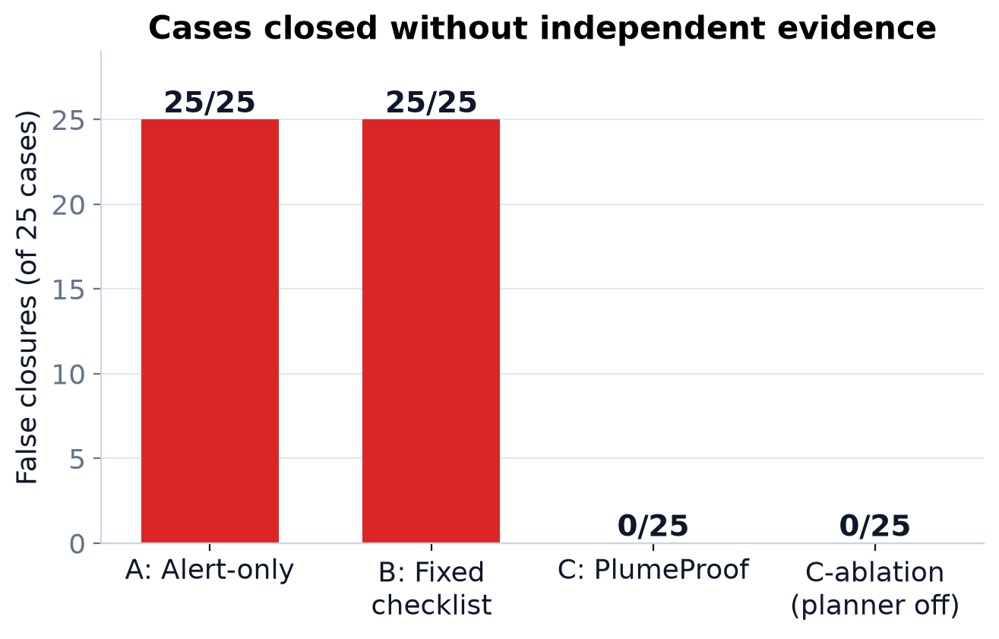

# 1. Problem and end users

Satellites now detect large methane plumes from space. The UN Methane Alert and Response System (MARS) has issued **more than 5,000 alerts in 33 countries**, but only **13%** have received a response, meaning the alert was investigated and reported back [1]. The UN target is an **80%** response rate by 2030 [1]. In a separate study, 1,015 AI-based notifications led to verified permanent mitigation at only six persistent emitters [5]. Methane drives about 30% of current warming and is about 80 times more potent than CO~2~ over 20 years [1, 7].

So detection is largely solved, but **follow-through** is not. After an alert, nobody owns the case. It is unclear who is accountable, which investigation to run first, whether a claimed repair actually worked, and whether the emissions came back. UNEP notes that satellite data alone cannot confirm mitigation [4].

**End users.** Regulators (for example a state pollution control board), municipal authorities that own a site, landfill and facility operators, and UN IMEO MARS national focal points.

**Test case.** Kanjur landfill in Mumbai was named among the world's three largest methane sources in a UN analysis [3]. Carbon Mapper observed two plumes there on 9 February 2025, of about 1,600 and 136 kg/h, and two plumes with a combined rate of about 3,300 kg/h on 3 April 2026 [2]. These were separate acquisitions under different conditions, not a continuous trend. Odour-control measures reduced complaints, but that does not show methane fell [2].

# 2. Solution and agent design

PlumeProof is a **persistent case agent**. It turns each plume into a managed investigation that can last months.

| | |
|--------|----------------------------------------------------------|
| **Input** | Satellite plume (location, emission rate, date), facility zones, stakeholder registry, operator records and field measurements |
| **Agent** | Keeps three competing source hypotheses, updates them with Bayes' rule, ranks investigations by expected information per rupee and per day, drafts notices and tracks deadlines |
| **Human approval** | Required for every investigation request, source attribution, notification and final closure |
| **Output** | A verdict with uncertainty (verified reduction, inconclusive or still leaking), an evidence-linked audit trail, and automatic reopening if emissions return |

**Why agentic.** A fixed checklist runs the same steps in the same order and closes when the operator reports a fix. PlumeProof keeps state across months, revises its beliefs after every result, chooses the next action by information value, re-plans when a resource becomes unavailable, refuses closure without independent evidence, and watches for recurrence after closure. The agent acts through six tools: `query_observations`, `overlay_facility_zones`, `rank_actions`, `draft_notice`, `track_deadline` and `evaluate_measurement`.

**Case lifecycle.** OPEN → SOURCE_ATTRIBUTION_PENDING → INVESTIGATION_REQUESTED → REPAIR_REPORTED → VERIFICATION_PENDING → {VERIFIED_REDUCTION | INCONCLUSIVE | STILL_LEAKING}. A verified case can move to RECURRING. There is **no edge** from REPAIR_REPORTED to VERIFIED_REDUCTION, so a repair claim can never close a case.

# 3. Methods

**Hypotheses and prior.** For Kanjur the three sources are the exposed waste surface, the gas-collection system and the flare. The prior is 50% / 35% / 15%, an entropy of $H = 1.44$ bits.

**Belief update.** After action $a$ gives outcome $y$:
$$P(h \mid y, a) \propto P(y \mid h, a)\,P(h).$$
For example, if the records request finds a fault ($P = 0.43$), the posterior becomes gas collection 65%, flare 29% and waste surface 6%, and the entropy falls to 1.16 bits. If it finds no fault, the waste surface rises to 84%.

**Expected information gain and ranking.**
$$\mathrm{EIG}(a) = H(P) - \sum_y P(y \mid a)\,H\big(P(\cdot \mid y, a)\big), \qquad \mathrm{score}(a) = \frac{\mathrm{EIG}(a)}{\mathrm{cost}(a) + \lambda\cdot \mathrm{days}(a)}$$
with $\lambda$ = ₹1,000 per day as the cost of delay. Actions that violate a constraint (for example an unavailable inspector or a missing permit) are excluded *before* ranking.

| Action | EIG (bits) | Cost | Days | Bits per ₹10k | Rank |
|----------------------------|-------:|-------:|----:|-------:|----:|
| Records request (flare, gas collection) | 0.50 | ₹2,000 | 1 | **2.50** | **1** |
| Gas-imaging (OGI) survey | 0.41 | ₹25,000 | 2 | 0.17 | 2 |
| Ground survey | **0.91** | ₹60,000 | 5 | 0.15 | 3 |
| Wait for next satellite pass | 0.00 | ₹0 | 30 | – | 4 |

The ground survey is the most informative, but the records request gives the most information per rupee and day, so it ranks first. A new satellite pass carries no information about *which* source is responsible.

**Verification rule.** A case is VERIFIED_REDUCTION only if
$$\text{post} + u_\text{post} < \text{pre} - u_\text{pre}$$
for an **independent** measurement under comparable conditions. An operator's claim alone returns NO_INDEPENDENT_EVIDENCE and the case stays VERIFICATION_PENDING. Conflicting independent measurements return INCONCLUSIVE. After verification, the recurrence threshold is the larger of the post-measurement upper bound and 100 kg/h.

At Kanjur, the pre-intervention rate is 1,736 ± 434 kg/h (real rates, with ±25% uncertainty as an assumption). The simulated follow-up is 610 ± 150 kg/h. Since 760 < 1,302, the result is a verified reduction, and the recurrence threshold is 760 kg/h.

{width=72%}

# 4. Implementation

- **Deterministic core:** Python 3.12, with Bayes, the EIG planner, the verification rule and the state machine as plain, tested modules.
- **Agent orchestrator:** hand-written, so every step is inspectable. It calls the six tools and places every critical action in an approval queue.
- **LLM at the edges only:** optional Claude drafting of notices and explanations, with a template fallback. The LLM cannot change any number, ranking, verdict or state. Without an API key the whole app runs on templates.
- **Backend:** FastAPI and Pydantic v2, with SQLite for cases, approvals and the full audit log.
- **Frontend:** React 18, Vite, Tailwind, a Leaflet map and Recharts. Pages include Replay, Map, Case, Planner, Approvals, Verification, Audit, Evaluation and What-if. An offline snapshot is used if the backend is unreachable.
- **Deployment:** a single Docker container on Render.
- **Quality:** 128 backend tests and 3 browser end-to-end tests.
- **Honest labelling:** every item is tagged REAL DATA, AGENT ACTION, SIMULATED EVENT or HUMAN DECISION.

# 5. Evaluation

We simulated **25 scenarios** (seed 2026), including unsupported repair claims, missing records, unavailable inspectors, conflicting measurements, ambiguous sources and recurrence. Each scenario's world, including its measurement noise, is sampled once, so every policy faces the same world. We compare three policies: **A**, alert-only; **B**, a fixed checklist; and **C**, PlumeProof. We also run **C-ablation**, with the planner replaced by "cheapest action first".

| Metric | A: Alert-only | B: Fixed checklist | C: PlumeProof | C-ablation |
|--------------------------------------|---------:|---------:|---------:|---------:|
| False closures | 25/25 | 25/25 | **0/25** | 0/25 |
| Resolved cases | 6 | 15 | **25** | 25 |
| Correct source attribution | 0% | 84% | **100%** | 100% |
| Inspections to identify the source, per case | 0.00 | 1.80 | **0.72** | 0.84 |
| Inspections per resolved case (incl. verification) | 0.00 | 3.00 | 3.00 | 3.24 |
| Cost per resolved case | ₹0 | ₹136,667 | ₹128,000 | ₹127,400 |
| Days to accountable stakeholder | 30 | 7 | **1** | 1 |
| Decision traceability | 0% | 82.8% | **100%** | 100% |
| Mean days to closure | 44.0 | 37.4 | 46.7 | 78.8 |

{width=60%}

**Reading the results honestly.** A and B close on the operator's claim, so every closure they make is false by design. The evaluation shows what the evidence gate costs (one independent verification campaign per case, included in C's 3.00 inspections) and that the planner still needs fewer inspections to identify the source than the checklist (0.72 vs 1.80). C reopened all 5 recurrence scenarios; A and B do no monitoring after closure.

**Ablation.** With the planner switched off, the evidence gate still gives 0 false closures, but mean days to closure rise from 46.7 to 78.8, because cheapest-first begins with a free 30-day satellite wait that carries 0 bits.

**Sensitivity.** In 200 draws, every likelihood was multiplied by a factor between 0.8 and 1.2 and renormalised. The top-ranked action was unchanged in 100% of draws, with a mean Kendall τ of 0.955 against the nominal ranking. When the agent runs on worlds whose *true* likelihoods are perturbed by ±20%, it still makes 0 false closures, with 2.36 inspections per resolved case.

# 6. Demo walkthrough

The live demo replays the Kanjur case in 11 presenter-driven steps. Every **Approve** click is a human decision.

1. **Real observation, 9 Feb 2025:** plumes of about 1,600 and 136 kg/h. The agent opens case KJ-2025-02 and resolves the accountable stakeholders from the facility zones.
2. **Hypotheses:** 50/35/15%, 1.44 bits.
3. **Planner:** the records request ranks first, and an approval is requested.
4. **Human approves** the records request.
5. **Simulated:** the gas-imaging (OGI) inspector is unavailable. The action is excluded and the plan is re-ranked.
6. **Simulated:** the records show a gas-system fault. Bayes moves gas collection to 65%, and attribution approval is requested.
7. **Attribution approved;** the agent requests approval for the notification to the operator.
8. **Simulated repair claim (20 Mar 2025):** CASE CLOSURE REJECTED, because a claim is not evidence.
9. **Simulated independent measurement (20 May 2025):** 610 ± 150 kg/h, VERIFIED REDUCTION. Closure approval is requested.
10. **Human approves closure;** the case is VERIFIED_REDUCTION.
11. **Real observation, 3 Apr 2026:** about 3,300 kg/h. The case is reopened automatically as RECURRING.

{width=80%}

# 7. Limitations and honest claims

- Likelihoods, action costs, durations and delays are **illustrative** demonstration values, chosen to reproduce our proposal's worked example. They are not calibrated.
- All operational events, stakeholder responses, the repair claim, follow-up measurements and the 25 evaluation scenarios are **simulated**. Only the Carbon Mapper plume rates and dates are real.
- The ±25% uncertainty on the satellite rate is an assumption. Plume positions inside the site, zone polygons and the wind arrow are illustrative.
- Measurement noise in the simulator is bounded ($|e| \le 0.8u$). With unbounded noise, rare false verified reductions become possible for any measurement-based policy.
- Policies A and B are our models of an alert-only system and a fixed checklist, not measurements of real systems.
- The expert review of priorities proposed in Round 1 has not been done yet.
- The ESP32 and MQ-4 demonstration sensor is uncalibrated and is not used for verification.

# 8. Future work

- Calibrate the likelihoods and costs with environmental engineers, and learn from closed cases, since every closed case is labelled data.
- Pilot with one regulator on live MARS alerts and real notification channels.
- Scale with Postgres/PostGIS, a task queue and regulator-specific jurisdiction tables.
- Extend to coal mines and oil and gas sites, with sector-specific hypotheses.

# References

[1] United Nations Environment Programme (UNEP). (23 June 2026). *UNEP, partners ramp up efforts to address major methane leaks as UN chief urges rapid cuts.* UNEP Press Release.

[2] Carbon Mapper. (22 July 2026). *Examining methane emissions at Mumbai waste sites.* <https://carbonmapper.org/articles/mumbai-waste-sites>

[3] Down To Earth. (5 May 2026). *UN methane alert system expanded to coal and waste sectors after Indian landfill named among world's top emitters.* downtoearth.org.in/climate-change

[4] UNEP International Methane Emissions Observatory (IMEO). (May 2026). *Mapping the world's biggest methane sources and tracking country response: MARS snapshot.* <https://methanedata.unep.org/story-MARS-snapshot>

[5] Allen, A., Mateo-Garcia, G., et al. (2025). *Artificial intelligence for methane detection: From continuous monitoring to verified mitigation.* arXiv:2511.21777.

[6] NASA/JPL-Caltech. (2022). *EMIT methane plume image, PIA25592.* <https://photojournal.jpl.nasa.gov/catalog/PIA25592>

[7] IISD SDG Knowledge Hub. (2025). *UN report calls for scaling action on methane through data-driven solutions.* sdg.iisd.org
